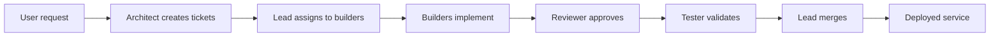

# Agent Studio

## Goal
Create a root `README.md` with product description, how it works, run locally instructions, test instructions, configuration table, deployment overview, safety rules, and repo map as specified in issue #64. Exclude the new pytest validation test.

## How it works
Agent Studio is a platform that orchestrates AI agents to build, test, and deploy software components. Agents communicate via GitHub issues, PRs, and automated workflows. The core flow:



## Run locally
```bash
# Clone the repo
git clone https://github.com/vyomya/agent-studio.git
cd agent-studio
# Setup virtual environment
python -m venv venv
source venv/bin/activate
# Install requirements
pip install -r requirements.txt
# Start the app (using mock generator)
GENERATOR_PROVIDER=mock hermes-agent run
```

## Run the tests
```bash
pytest -q
```

## Configuration
| Environment Variable | Description | Default |
|----------------------|-------------|---------|
| GENERATOR_PROVIDER   | Provider for text generation (mock, openai, etc.) | mock |
| RETRY_LIMIT          | Number of retry attempts for failed tasks | 3 |
| MODEL_ALLOWANCE      | Token allowance per model per day | 100000 |
| DATABASE_URL         | URL for SQLite/Postgres DB (empty for in‑memory) | '' |

## Deploy
The application can be deployed via Docker Compose, Caddy, and a timer that auto‑deploys changes.
- **Installation script**: `deploy/install.sh`
- **Docker Compose**: `docker-compose.yml`
- **Caddy**: `Caddyfile` in `infra/`
- **SSL**: Uses `sslip.io` for automatic TLS.
- **Auto‑deploy**: Timer triggers `hermes-agent run` daily.
- **Infrastructure**: See `infra/` directory for cloud‑init and Terraform configs.

## Safety rules
- Invalid or unsafe pages are never saved or displayed.
- Generated pages are sandboxed and isolated from the main site.
- Model token usage is capped by `MODEL_ALLOWANCE`.
- All inputs are validated before processing.

## Repo map
- `docs/` – Documentation, including this `ARCHITECTURE.md`.
- `infra/` – Infrastructure as code (Terraform, cloud‑init).
- `scripts/` – Helper scripts for setup and checks.
- `agents/` – Agent definitions and role specifications.
- `PLAN.md` – High‑level product plan.
- `DELIVERY.md` – Delivery milestones and token usage.
- `tests/` – Test suite (future).

---
*Generated by architect agent.*